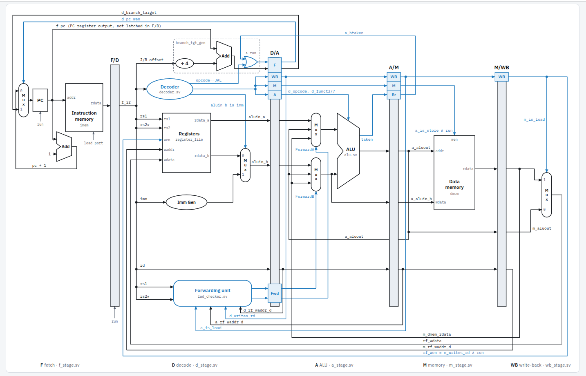

# Hazards

## Hazards Handling (H&P)

The following proposal adapts the hazard handling from Patterson & Hennessy, *Computer Organization and Design, RISC-V Edition* to our pipeline. 

| # | Hazard | Detect | Action |
|---|---|---|---|
| 1 | `rs` written by the instr in A/M | `a_writes_rd && a_rf_waddr_d != 0 && a_rf_waddr_d == rs` | forward `a_aluout` |
| 2 | `rs` written by the instr in M/WB | `m_writes_rd && m_rf_waddr_d != 0 && m_rf_waddr_d == rs && !1` | forward `rf_wdata` |
| 3 | `rs` read in D while WB writes it *(Not in H&P since Register File allows to read current write value)* | `rf_wen && rf_waddr != 0 && rf_waddr == rs` | RF write->read bypass |
| 4 | Load-use: `rs` written by the load in D/A | `d_is_load && d_rf_waddr_d == rs` | stall 1 cycle |

- 1 and 2: the forwarding unit is in A, and `rs` comes from D/A.
- 3: the bypass goes inside the register file (read in D).
- 4: the hazard detection unit is in D, and `rs` comes from F/D.

[!NOTE] Stall = hold the PC, hold F/D, and put a bubble in D/A (control bits = 0).

[!NOTE] The immediate is selected after the forwarding mux (in A), and the forwarded rs2 goes to A/M as store data.

## Current Implementation Review

- Covered: 1, 2 (when producer is load)
- Not covered: 3, 4

### Further considerations on current implementation
Also to notice, writes to x0 get forwarded.
Because 4 is missing, an instruction right after a load gets the load address (`a_aluout`) instead of the data.
There is no priority check for when 1 and 2 happens together, currently the older value is used.
The immediate is selected in D, before the forwarding mux, so forwarding operand B overwrites it, and stores write the immediate instead of rs2.
